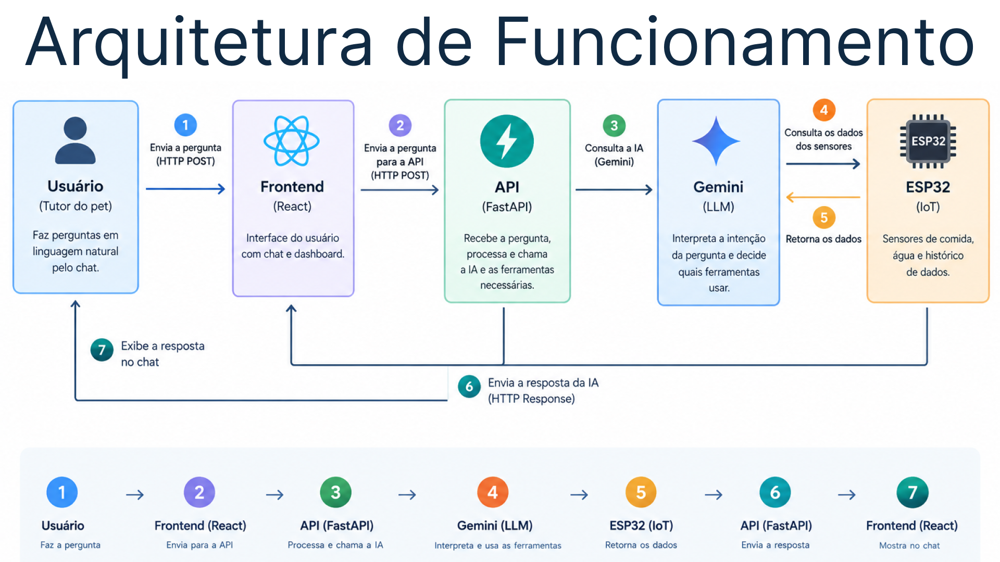
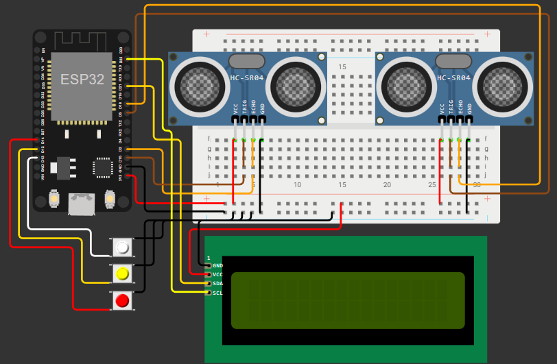

# 🐾 CLYVO VET --- IoT, Inteligência Artificial e PetCenter

> Assistente inteligente para acompanhamento de pets, desenvolvido com
> **Python, FastAPI, Google Gemini, React e integração com a API Java
> Spring Boot do PetCenter**. O projeto também mantém sua implementação
> original de monitoramento IoT com ESP32 e Wokwi.

------------------------------------------------------------------------

> **Atualização da arquitetura:** o projeto começou com o monitoramento
> de alimentação e hidratação por IoT (ESP32). Na evolução mais recente,
> o assistente de IA passou a consultar os dados cadastrados na **API
> Java do PetCenter**, utilizando autenticação JWT. A documentação de
> hardware e simulação IoT foi mantida neste README como parte da
> evolução e do histórico do projeto. Na versão atual do assistente, as
> consultas de pets, diário, alertas e veterinários são realizadas pela
> API Java, e não diretamente pelo ESP32.

------------------------------------------------------------------------

## 🔄 Evolução: integração com a API Java PetCenter

A camada de Inteligência Artificial do CLYVO VET foi adaptada para
trabalhar com os dados mantidos pelo backend Java do PetCenter. Essa
integração substitui, no fluxo atual do assistente, as consultas diretas
aos endpoints IoT por chamadas HTTP à API REST Java.

O front-end do PetCenter está em um repositório separado, desenvolvido
por ArthurCPV. Ele se comunica com a API Java, enquanto a API de IA do
CLYVO VET, desenvolvida neste projeto, fica responsável pelo assistente
inteligente e pela integração com os dados do PetCenter.

**Repositório do backend Java:**\
https://github.com/Marixavq/challenge-java-petcenter/tree/sprint-final

**Documentação Swagger:** - Ambiente local:
http://localhost:8080/swagger-ui/index.html - Ambiente publicado no
Render:
https://challenge-java-petcenter.onrender.com/swagger-ui/index.html

### Objetivo da integração

Permitir que o tutor converse com o CLYVO VET em linguagem natural e
receba respostas baseadas nos dados reais registrados no PetCenter,
como:

-   pets vinculados ao usuário;
-   informações cadastrais de cada pet;
-   diário e registros de acompanhamento;
-   veterinários relacionados ao pet;
-   alertas cadastrados;
-   solicitações de atendimento veterinário.

O Gemini interpreta a pergunta e seleciona as ferramentas disponíveis.
As ferramentas Python consultam a API Java, organizam os dados
retornados e entregam o resultado ao modelo para elaboração da resposta.

### Arquitetura atual da IA

``` text
┌──────────────────────────────┐
│        Frontend React        │
│       Interface de chat      │
└──────────────┬───────────────┘
               │ HTTP
               ▼
┌──────────────────────────────┐
│          FastAPI             │
│           /chat              │
└──────────────┬───────────────┘
               │
               ▼
┌──────────────────────────────┐
│        Google Gemini         │
│ Interpretação e tool calling │
└──────────────┬───────────────┘
               │
               ▼
┌──────────────────────────────┐
│       Tools em Python        │
│ Consultas à API PetCenter    │
└──────────────┬───────────────┘
               │ HTTP + Bearer JWT
               ▼
┌──────────────────────────────┐
│   API Java Spring Boot       │
│          PetCenter           │
└──────────────┬───────────────┘
               │
               ▼
┌──────────────────────────────┐
│       Banco de dados         │
│       do PetCenter           │
└──────────────────────────────┘
```

O frontend conversa somente com a API FastAPI do assistente. O backend
Python é responsável por chamar a API Java. O Gemini não acessa
diretamente o banco de dados.

### Autenticação com JWT

A API Java utiliza autenticação Bearer Token para proteger os recursos
privados. O fluxo implementado no assistente utiliza um JWT configurado
no ambiente do backend Python.

1.  O backend Python carrega o JWT configurado em variável de ambiente.
2.  O token é utilizado no cabeçalho `Authorization: Bearer <token>` das
    requisições protegidas.
3.  O assistente obtém o e-mail associado ao token a partir da
    informação `sub` do JWT.
4.  O backend consulta o endpoint de usuário por e-mail para obter o
    identificador (`id`).
5.  Com o identificador, as ferramentas consultam os pets e os demais
    dados autorizados.

**Importante:** o token é uma credencial privada. Ele deve permanecer no
ambiente do backend e nunca ser colocado no código React, no repositório
Git ou neste README. O uso de um token fixo atende ao cenário de teste
com um usuário configurado; para uma aplicação com vários tutores, o
ideal é encaminhar o JWT individual de cada usuário autenticado.

### Endpoints PetCenter utilizados pelo assistente

Os endpoints abaixo são os recursos identificados na documentação da API
utilizados como base para a integração. Consulte o Swagger para conferir
parâmetros, paginação, formatos e permissões atualizados.

  -------------------------------------------------------------------------------------
  Método                  Endpoint                              Finalidade
  ----------------------- ------------------------------------- -----------------------
  `POST`                  `/api/auth/login`                     Autenticar usuário e
                                                                obter JWT

  `GET`                   `/api/users/email/{email}`            Localizar o usuário
                                                                pelo e-mail associado à
                                                                autenticação

  `GET`                   `/api/pets/user/{userId}`             Listar os pets
                                                                vinculados ao usuário

  `GET`                   `/api/pets/{id}`                      Consultar os dados de
                                                                um pet

  `GET`                   `/api/diarioentradas`                 Consultar entradas do
                                                                diário

  `GET`                   `/api/diarioentradas/data/{data}`     Consultar entradas do
                                                                diário por data

  `GET`                   `/api/pet-veterinarios/pet/{petId}`   Consultar veterinários
                                                                relacionados ao pet

  `GET`                   `/api/alertas/pet/{petId}`            Consultar alertas
                                                                associados ao pet

  `GET`                   `/api/solicitacoes`                   Consultar solicitações
  -------------------------------------------------------------------------------------

Os endpoints protegidos devem receber o cabeçalho:

``` http
Authorization: Bearer SEU_JWT
```

O login utiliza o corpo de requisição definido pela API Java, com
`email` e `senha`, e retorna um token JWT. No fluxo atual do assistente
com token fixo, o login não precisa ser repetido a cada pergunta: o
token configurado no ambiente é utilizado nas chamadas protegidas até
expirar ou deixar de ser válido.

**Limitação conhecida:** a documentação consultada não apresentou um
endpoint específico para listar consultas veterinárias agendadas. O
assistente não deve afirmar que existem consultas marcadas nem inventar
datas. Solicitações de atendimento e veterinários relacionados não são a
mesma coisa que uma agenda de consultas.

### Dados disponíveis para o assistente

Entre os dados retornados pela API Java estão:

-   **Pet:** identificador, nome do tutor, nome do pet, espécie, raça,
    data de nascimento e observações.
-   **Diário:** identificador, pet relacionado, data, resumo, humor
    geral, status e datas de criação/atualização.
-   **Registros do diário:** tipo, subtipo, valor, unidade, nota,
    horário e entrada relacionada.
-   **Veterinário:** nome, CRMV, especialidade e descrição.
-   **Solicitação:** pet, tutor, veterinário, status, mensagem e datas
    de criação/resposta.
-   **Usuário:** identificador, nome, e-mail, telefone, tipo de usuário,
    situação e data de criação.

A disponibilidade de cada informação depende dos registros existentes na
API e das permissões do usuário autenticado.

### Exemplos de perguntas para a integração PetCenter

``` text
Quais pets estão cadastrados na minha conta?
```

``` text
Quais são os dados cadastrados do meu pet?
```

``` text
Faça um resumo do diário do meu pet.
```

``` text
Quais registros foram feitos em determinada data?
```

``` text
Quais veterinários estão relacionados ao meu pet?
```

``` text
Existem alertas cadastrados para meu pet?
```

``` text
Quais são minhas solicitações de atendimento?
```

O assistente deve responder somente com informações retornadas pela API.
Quando não houver dados, deve informar que não encontrou registros, sem
completar lacunas por suposição.

### Deploy da API de IA no Render

A API FastAPI do CLYVO VET pode ser publicada como um Web Service no
Render. Configure as variáveis de ambiente no painel do serviço, em
**Environment**:

  Variável                Descrição
  ----------------------- ----------------------------------------------
  `API_KEY`               Chave da API Google Gemini
  `MODEL_NAME`            Nome do modelo Gemini utilizado pelo projeto
  `PETCENTER_BASE_URL`    URL base da API Java PetCenter
  `PETCENTER_API_TOKEN`   JWT utilizado nas chamadas protegidas

Exemplo de URL base:

``` env
PETCENTER_BASE_URL=https://challenge-java-petcenter.onrender.com
```

Não inclua valores reais de chaves ou tokens no README. Cadastre os
segredos diretamente no painel do Render. Após salvar as variáveis,
realize um novo deploy para que a aplicação carregue as configurações.

Comando de inicialização utilizado no Render:

``` bash
uvicorn api:app --host 0.0.0.0 --port $PORT
```

Para execução local, o comando pode ser:

``` powershell
python -m uvicorn api:app --reload --host 0.0.0.0 --port 8000
```

------------------------------------------------------------------------

## 📌 Sobre o Projeto

O **CLYVO VET** é uma solução desenvolvida para auxiliar no
acompanhamento da rotina de animais domésticos por meio da coleta e
interpretação de dados.

O sistema utiliza sensores conectados a um **ESP32** para identificar a
aproximação do pet aos recipientes de comida e água.

Esses eventos são registrados com data e horário e disponibilizados por
uma API REST em formato JSON.

Além do monitoramento IoT, o projeto possui um **Assistente Virtual
baseado em Inteligência Artificial Generativa**, permitindo que o tutor
consulte os dados utilizando linguagem natural.

O projeto combina:

-   🌐 Internet das Coisas (IoT)
-   🤖 Inteligência Artificial Generativa
-   🔌 API REST
-   ⚡ ESP32
-   📊 Dados estruturados
-   💻 React
-   🐍 Python
-   🔬 Wokwi

------------------------------------------------------------------------

# 🎯 Objetivo

O objetivo do CLYVO VET é transformar informações da rotina do pet em
dados organizados e acessíveis.

O sistema permite acompanhar:

-   quantidade de visitas ao recipiente de comida;
-   quantidade de visitas ao recipiente de água;
-   horários das visitas;
-   histórico diário;
-   comparação entre dias;
-   consultas utilizando linguagem natural.

A proposta é facilitar o acompanhamento da rotina do animal e fornecer
informações que possam auxiliar tutores e profissionais veterinários.

> ⚠️ Os dados coletados pelo sistema representam apenas interações do
> pet com os recipientes. O CLYVO VET não realiza diagnóstico
> veterinário e não substitui um médico veterinário.

------------------------------------------------------------------------

# 🧠 Conceito

O CLYVO VET foi pensado como um **Diário Inteligente do Pet**.

A ideia é utilizar tecnologia para transformar eventos simples da rotina
em informações organizadas.

``` text
Pet
 │
 ▼
Sensores IoT
 │
 ▼
ESP32
 │
 ▼
API REST
 │
 ├──────────────► Dashboard
 │
 ▼
FastAPI
 │
 ▼
Inteligência Artificial
 │
 ▼
Assistente CLYVO VET
 │
 ▼
Tutor
```

------------------------------------------------------------------------

# 🚀 Funcionalidades

## 🐕 Monitoramento IoT

-   Detecção da aproximação do pet ao recipiente de comida.
-   Detecção da aproximação do pet ao recipiente de água.
-   Contagem automática dos eventos.
-   Registro dos horários.
-   Registro da data.
-   Histórico diário.
-   Reset automático dos contadores ao iniciar um novo dia.

## 📡 API do ESP32

O ESP32 disponibiliza os dados através de endpoints HTTP:

-   `/status`
-   `/comida`
-   `/agua`
-   `/historico`

## 🤖 Inteligência Artificial

O assistente permite realizar perguntas em linguagem natural, como:

``` text
Quantas vezes meu pet comeu hoje?
```

``` text
Que horas ele bebeu água?
```

``` text
Ele comeu mais ontem ou hoje?
```

Na implementação original, a IA consultava os dados do sistema IoT. Na
versão atual integrada ao PetCenter, o assistente consulta os dados
reais disponibilizados pela API Java antes de responder.

## 💻 Aplicação Web

O projeto também possui uma aplicação frontend desenvolvida em:

-   React
-   Vite
-   JavaScript
-   Lucide React

O frontend permite conversar com o Assistente CLYVO VET através de uma
interface de chat.

------------------------------------------------------------------------

# 🏗️ Arquitetura do Projeto

A arquitetura atual é dividida em três partes principais:

``` text
┌──────────────────────────────┐
│          CLYVO VET           │
└──────────────────────────────┘
               │
       ┌───────┴────────┐
       │                │
       ▼                ▼
┌─────────────┐   ┌─────────────┐
│     IoT     │   │  Frontend   │
│    ESP32    │   │    React    │
└──────┬──────┘   └──────┬──────┘
       │                 │
       │ HTTP/JSON       │ HTTP
       ▼                 ▼
┌──────────────────────────────┐
│          FastAPI             │
│          /chat               │
└──────────────┬───────────────┘
               │
               ▼
┌──────────────────────────────┐
│       Google Gemini          │
│    Generative AI Agent       │
└──────────────┬───────────────┘
               │
               ▼
┌──────────────────────────────┐
│            Tools             │
│  status / comida / agua /    │
│          historico           │
└──────────────┬───────────────┘
               │
               ▼
┌──────────────────────────────┐
│        ESP32 / Wokwi         │
└──────────────────────────────┘
```

Ou:



------------------------------------------------------------------------

# 📂 Estrutura do Projeto

``` text
Challenger_IOT/
│
├── .gitignore
├── README.md
├── Projeto_IOT.png
│
├── IOT/
│   ├── diagram.json
│   ├── libraries.txt
│   ├── wokwi-project.txt
│   ├── wokwi.toml
│   │
│   └── sketch/
│       └── sketch.ino
│
├── IA/
│   ├── api.py
│   ├── config.py
│   ├── main.py
│   ├── requirements.txt
│   ├── schemas.py
│   ├── SYSTEM_PROMPT.py
│   └── tools.py
│
└── frontend_test/
    ├── index.html
    ├── package.json
    ├── package-lock.json
    │
    └── src/
        ├── main.jsx
        └── styles.css
```

------------------------------------------------------------------------

# 🔌 Parte IoT

O sistema IoT utiliza um **ESP32 DevKit** conectado a dois sensores
ultrassônicos HC-SR04.

Cada sensor é responsável por monitorar um recipiente.

``` text
HC-SR04 #1
   │
   ▼
Comida 🍖

HC-SR04 #2
   │
   ▼
Água 💧
```

Quando o sensor identifica uma aproximação dentro do limite configurado,
o ESP32 registra o evento.

------------------------------------------------------------------------

# 🔧 Componentes

## Hardware

-   ESP32 DevKit
-   2x HC-SR04
-   LCD 16x2 I2C
-   3x Push Buttons
-   Protoboard
-   Jumpers

O projeto também pode ser executado utilizando a simulação do **Wokwi**.

------------------------------------------------------------------------

# 📌 Mapeamento dos Pinos

## 🍖 Sensor de Comida

  HC-SR04   ESP32
  --------- ---------
  TRIG      GPIO 5
  ECHO      GPIO 18

## 💧 Sensor de Água

  HC-SR04   ESP32
  --------- ---------
  TRIG      GPIO 15
  ECHO      GPIO 2

## 📺 LCD I2C

  LCD   ESP32
  ----- ---------
  SDA   GPIO 21
  SCL   GPIO 22
  VCC   3V3
  GND   GND

## 🔘 Botões

  Função   GPIO
  -------- ---------
  STATUS   GPIO 13
  ÁGUA     GPIO 12
  COMIDA   GPIO 14

------------------------------------------------------------------------

# 📏 Detecção

O limite utilizado para identificar a aproximação do pet é:

``` cpp
const int LIMITE = 15;
```

Quando a distância detectada fica dentro desse limite, o sistema
considera que houve uma interação com o recipiente.

O evento então:

1.  é detectado pelo HC-SR04;
2.  é processado pelo ESP32;
3.  recebe data e horário;
4.  incrementa o contador;
5.  armazena o horário;
6.  fica disponível através da API.

------------------------------------------------------------------------

# 🕐 Data e Horário

O ESP32 utiliza **NTP (Network Time Protocol)** para sincronização do
horário.

Configuração utilizada:

``` cpp
const char* ntpServer = "pool.ntp.org";
const long gmtOffset_sec = -3 * 3600;
const int daylightOffset_sec = 0;
```

O sistema utiliza o horário correspondente ao fuso de Brasília.

------------------------------------------------------------------------

# 📅 Histórico Diário

O ESP32 mantém registros organizados por data.

Quando identifica uma mudança de dia:

``` text
Dia anterior
     │
     ▼
Salva histórico
     │
     ▼
Novo dia
     │
     ▼
Zera contadores
     │
     ▼
Começa novos registros
```

O histórico pode ser consultado através do endpoint:

``` text
GET /historico
```

------------------------------------------------------------------------

# 📡 API REST do ESP32

O ESP32 utiliza `WebServer` para disponibilizar os dados em JSON.

A configuração atual do Wokwi encaminha:

``` text
http://localhost:8280
```

para a porta HTTP do ESP32.

------------------------------------------------------------------------

## GET `/status`

Retorna o resumo do dia atual.

### Exemplo

``` json
{
  "data": "12/03/2026",
  "visitasComida": 5,
  "visitasAgua": 3
}
```

------------------------------------------------------------------------

## GET `/comida`

Retorna os eventos relacionados à alimentação.

### Exemplo

``` json
{
  "data": "12/03/2026",
  "visitasComida": 5,
  "visitaHorario": [
    "08:10:22",
    "12:40:11",
    "18:30:45"
  ]
}
```

------------------------------------------------------------------------

## GET `/agua`

Retorna os eventos relacionados à hidratação.

### Exemplo

``` json
{
  "data": "12/03/2026",
  "visitasAgua": 3,
  "visitaHorario": [
    "09:14:55",
    "13:02:10",
    "20:15:30"
  ]
}
```

------------------------------------------------------------------------

## GET `/historico`

Retorna o histórico diário.

### Exemplo

``` json
{
  "12/03/2026": {
    "visitasComida": 5,
    "visitasAgua": 3
  },
  "13/03/2026": {
    "visitasComida": 7,
    "visitasAgua": 5
  }
}
```

------------------------------------------------------------------------

# 📺 LCD

O LCD apresenta informações do monitoramento diretamente no dispositivo.

Durante a inicialização:

``` text
Iniciando...
```

Durante a conexão:

``` text
Conectando
WiFi...
```

Após conectar:

``` text
WiFi conectado
```

O IP do ESP32 também é apresentado:

``` text
IP:
192.168.x.x
```

Após a inicialização, o LCD apresenta:

``` text
Refeicoes: X
Hidratacao: X
```

Quando um evento é detectado, o display apresenta temporariamente a
informação correspondente.

------------------------------------------------------------------------

# 🔘 Botões

O dispositivo possui três botões físicos.

## STATUS --- GPIO 13

Exibe os dados do endpoint `/status` no Serial Monitor.

## ÁGUA --- GPIO 12

Exibe os dados de hidratação.

## COMIDA --- GPIO 14

Exibe os dados de alimentação.

------------------------------------------------------------------------

# 🤖 Inteligência Artificial

A camada de Inteligência Artificial foi desenvolvida em **Python**
utilizando a API do **Google Gemini**.

Na versão inicial, o agente interpretava perguntas relacionadas aos
dados coletados pelo IoT. Na versão atual, ele também utiliza
ferramentas Python para consultar a API Java Spring Boot do PetCenter,
permitindo responder perguntas sobre pets, diário, registros,
veterinários, alertas e solicitações.

------------------------------------------------------------------------

# 🐍 Backend da IA

O backend utiliza:

-   Python
-   FastAPI
-   Uvicorn
-   Pydantic
-   Requests
-   Google GenAI

As dependências estão disponíveis em:

``` text
IA/requirements.txt
```

Conteúdo atual:

``` text
fastapi
uvicorn
requests
pydantic
google-genai>=2.3.0
```

------------------------------------------------------------------------

# 🔌 API FastAPI

O arquivo:

``` text
IA/api.py
```

cria a API responsável por receber as mensagens do frontend.

A aplicação é criada com:

``` python
app = FastAPI(
    title="CLYVO VET API",
    description="API de inteligência artificial do CLYVO VET",
    version="1.0.0"
)
```

------------------------------------------------------------------------

# 💬 Endpoint `/chat`

A API possui o endpoint:

``` text
POST /chat
```

### Request

``` json
{
  "message": "Quantas vezes meu pet comeu hoje?"
}
```

### Response

``` json
{
  "response": "Hoje foram registradas 5 visitas à comida."
}
```

------------------------------------------------------------------------

# 🧠 Funcionamento do Agente

O fluxo de uma pergunta é:

``` text
Usuário
   │
   ▼
React
   │
   ▼
POST /chat
   │
   ▼
FastAPI
   │
   ▼
Gemini
   │
   ▼
Interpretação da pergunta
   │
   ▼
Tool apropriada
   │
   ▼
ESP32
   │
   ▼
JSON
   │
   ▼
Gemini
   │
   ▼
Resposta
   │
   ▼
React
```

------------------------------------------------------------------------

# 🛠️ Tools

As ferramentas responsáveis por consultar os dados estão em. Na
implementação original, elas consultavam os endpoints IoT; na integração
atual, as ferramentas consultam os endpoints da API Java PetCenter:

``` text
IA/tools.py
```

A versão original possuía quatro ferramentas para o ESP32
(`consultar_status`, `consultar_comida`, `consultar_agua` e
`consultar_historico`). Na versão atual integrada ao PetCenter, as
ferramentas são direcionadas às consultas de usuário, pets, diário,
veterinários, alertas e solicitações.

## `consultar_status()`

Consulta:

``` text
GET /status
```

Retorna o resumo atual.

------------------------------------------------------------------------

## `consultar_comida()`

Consulta:

``` text
GET /comida
```

Retorna:

-   quantidade de visitas;
-   horários;
-   data.

------------------------------------------------------------------------

## `consultar_agua()`

Consulta:

``` text
GET /agua
```

Retorna:

-   quantidade de visitas;
-   horários;
-   data.

------------------------------------------------------------------------

## `consultar_historico()`

Consulta:

``` text
GET /historico
```

Retorna os dados históricos organizados por data.

------------------------------------------------------------------------

# 🧩 Pydantic

O projeto utiliza Pydantic para estruturar e validar informações do
monitoramento.

A classe principal está localizada em:

``` text
IA/schemas.py
```

A estrutura `FichaMonitoramento` representa uma consulta realizada pelo
assistente.

Ela possui informações como:

``` text
nome_pet
tipo_consulta
data
informacao_solicitada
visitas_comida
visitas_agua
horarios_comida
horarios_agua
resposta
```

Isso permite manter os dados retornados pelo modelo em um formato
estruturado.

------------------------------------------------------------------------

# 🛡️ Regras da Inteligência Artificial

O comportamento do assistente é definido em:

``` text
IA/SYSTEM_PROMPT.py
```

O sistema possui regras para:

-   não inventar dados;
-   consultar a fonte de dados correspondente quando necessário (IoT na
    versão original ou API Java PetCenter na versão atual);
-   responder utilizando dados reais;
-   realizar comparações apenas quando houver dados;
-   manter o contexto do CLYVO VET;
-   evitar diagnósticos veterinários;
-   orientar a procura de um profissional quando necessário.

------------------------------------------------------------------------

# 🚫 Não Invenção de Dados

O assistente não deve criar:

-   números;
-   horários;
-   datas;
-   registros;
-   informações sobre o pet que não estejam disponíveis.

Por exemplo:

``` text
Usuário:
Quantas vezes meu pet comeu hoje?

IoT:
visitasComida = 5

Assistente:
Hoje foram registradas 5 visitas à comida.
```

Caso os dados não estejam disponíveis, o assistente deve informar isso
ao usuário.

------------------------------------------------------------------------

# 🩺 Limitação Veterinária

O CLYVO VET não substitui um médico veterinário.

Os sensores registram apenas interações com os recipientes.

Portanto, os dados não são suficientes para determinar:

-   doenças;
-   desidratação;
-   condições clínicas;
-   diagnósticos;
-   necessidade de medicamentos.

Em situações relacionadas à saúde do animal, o usuário deve procurar um
médico veterinário.

------------------------------------------------------------------------

# 💻 Frontend de Teste

O frontend está localizado em:

``` text
frontend_test/
```

A aplicação foi desenvolvida utilizando:

-   React
-   Vite
-   JavaScript
-   Lucide React
-   CSS

------------------------------------------------------------------------

# 🖥️ Interface

O frontend possui uma interface de chat para conversar com o Assistente
CLYVO VET.

A aplicação utiliza a variável `VITE_API_URL` para definir o endereço da
API FastAPI. Caso ela não esteja configurada, o frontend utiliza
`http://localhost:8000` como padrão.

Portanto, por padrão, o frontend espera que a API FastAPI esteja
disponível em:

``` text
http://localhost:8000
```

------------------------------------------------------------------------

# 🔄 Comunicação Frontend → FastAPI

Quando o usuário envia uma pergunta, o React realiza uma requisição ao
backend FastAPI. Na configuração com JWT fixo no servidor, o frontend
envia a mensagem e o backend utiliza o token privado configurado no
ambiente para consultar o PetCenter:

``` http
POST http://localhost:8000/chat
```

com:

``` json
{
  "message": "Quantas vezes meu pet comeu hoje?"
}
```

A resposta recebida:

``` json
{
  "response": "Hoje foram registradas 5 visitas à comida."
}
```

é então apresentada na interface.

------------------------------------------------------------------------

# 🌐 CORS

A API FastAPI possui configuração de CORS para permitir que o frontend
React realize requisições.

Atualmente:

``` python
allow_origins=["*"]
```

Isso facilita os testes locais entre frontend e backend.

Para um ambiente de produção, recomenda-se restringir as origens
autorizadas.

------------------------------------------------------------------------

# 🔐 Configuração da API Key

As configurações do Gemini e da integração com a API Java PetCenter
estão em:

``` text
IA/config.py
```

A versão atual utiliza variáveis de ambiente para configurar o Gemini e
a API Java PetCenter. Crie um arquivo `.env` na pasta `IA` para execução
local, utilizando os nomes documentados na seção **Deploy da API de IA
no Render**. Não versione esse arquivo.

> ⚠️ Nunca publique uma API Key válida, um JWT ou qualquer outra
> credencial no GitHub.

------------------------------------------------------------------------

# ⚙️ Como Executar

## 1. Clonar o projeto

``` bash
git clone https://github.com/ZeDio/Challenger_IOT.git
```

Entre na pasta:

``` bash
cd Challenger_IOT
```

------------------------------------------------------------------------

# 2. Executar o IoT

Abra o projeto no Wokwi ou execute a simulação localmente.

Os principais arquivos são:

``` text
IOT/
├── diagram.json
├── wokwi.toml
└── sketch/
    └── sketch.ino
```

O projeto Wokwi também está disponível em:

https://wokwi.com/projects/463362553076345857

------------------------------------------------------------------------

# 3. Preparar o ambiente Python

Entre na pasta da IA:

``` powershell
cd IA
```

Recomenda-se criar um ambiente virtual:

``` powershell
py -m venv .venv
```

Ative o ambiente:

``` powershell
.\.venv\Scripts\Activate.ps1
```

Caso o PowerShell bloqueie a ativação do ambiente virtual, você pode
executar os comandos usando diretamente:

``` powershell
py -m pip
```

sem precisar ativá-lo.

------------------------------------------------------------------------

# 4. Instalar as dependências

Com o ambiente virtual ativo:

``` powershell
python -m pip install -r requirements.txt
```

Ou utilizando o Python Launcher:

``` powershell
py -m pip install -r requirements.txt
```

------------------------------------------------------------------------

# 5. Configurar a API Key

Abra:

``` text
IA/config.py
```

Configure sua chave do Google Gemini.

Exemplo:

``` python
API_KEY = "SUA_API_KEY"
```

------------------------------------------------------------------------

# 6. Iniciar a API FastAPI

Ainda dentro da pasta `IA`, execute:

``` powershell
py -m uvicorn api:app --reload
```

A API estará disponível em:

``` text
http://localhost:8000
```

------------------------------------------------------------------------

# 7. Documentação da API

O FastAPI gera automaticamente a documentação interativa.

Acesse:

``` text
http://localhost:8000/docs
```

Também é possível acessar a documentação alternativa:

``` text
http://localhost:8000/redoc
```

------------------------------------------------------------------------

# 8. Executar o Frontend

Abra outro terminal.

Entre na pasta:

``` powershell
cd frontend_test
```

Instale as dependências:

``` powershell
npm install
```

Execute:

``` powershell
npm run dev
```

O Vite fornecerá o endereço local da aplicação, normalmente:

``` text
http://localhost:5173
```

------------------------------------------------------------------------

# 9. Executar o Assistente pelo Terminal

Além da API utilizada pelo React, existe uma versão de interação
diretamente pelo terminal.

Dentro da pasta `IA`:

``` powershell
py main.py
```

O sistema exibirá:

``` text
--- Assistente CLYVO VET iniciado ---
```

O usuário pode então realizar perguntas diretamente pelo terminal.

Para encerrar:

``` text
sair
```

Também são aceitos:

``` text
encerrar
parar
```

------------------------------------------------------------------------

# 🔄 Execução Completa

Para executar o projeto completo:

### Terminal 1 --- IoT

Inicie a simulação do ESP32 no Wokwi.

### Terminal 2 --- FastAPI

``` powershell
cd IA
py -m uvicorn api:app --reload
```

### Terminal 3 --- React

``` powershell
cd frontend_test
npm install
npm run dev
```

Depois abra o endereço fornecido pelo Vite.

------------------------------------------------------------------------

# 🧪 Exemplos de Perguntas

Após iniciar o sistema, o usuário pode perguntar:

### Alimentação

``` text
Quantas vezes meu pet comeu hoje?
```

``` text
Que horas ele comeu?
```

``` text
Qual foi a primeira refeição?
```

``` text
Qual foi a última vez que ele comeu?
```

### Hidratação

``` text
Quantas vezes meu pet bebeu água hoje?
```

``` text
Que horas ele bebeu água?
```

``` text
Qual foi o último horário que ele bebeu água?
```

### Histórico

``` text
Como foi o dia de ontem?
```

``` text
Qual dia teve mais refeições?
```

``` text
Ele bebeu mais água ontem ou hoje?
```

------------------------------------------------------------------------

# 📊 Exemplo de Fluxo

Pergunta:

``` text
Ele comeu mais ontem ou hoje?
```

A IA consulta o histórico:

``` json
{
  "12/03/2026": {
    "visitasComida": 5,
    "visitasAgua": 3
  },
  "13/03/2026": {
    "visitasComida": 7,
    "visitasAgua": 5
  }
}
```

E pode responder:

``` text
Hoje foram registradas 7 visitas à comida,
enquanto ontem foram 5. Portanto, hoje foram
registradas 2 visitas a mais.
```

------------------------------------------------------------------------

# 🖼️ Preview



------------------------------------------------------------------------

# 🎥 Demonstrações

Vídeos demonstrativos:

Sprint 1 e 2: https://youtu.be/ngr6tGGZNsc

Sprint 3: https://youtu.be/\_r_kbnhGVq0

Sprint 4: https://youtu.be/Z4YKXAoPKlU

------------------------------------------------------------------------

# 🔗 Links

## GitHub

Repositório principal do CLYVO VET (integração de IA):\
https://github.com/ZeDio/Challenger_IOT

Front-end PetCenter (desenvolvido por ArthurCPV):\
https://github.com/ArthurCPV/PetCenter

## APIs publicadas

API de Inteligência Artificial do CLYVO VET (Render):\
https://challenger-iot.onrender.com

API Java do PetCenter (Render):\
https://challenge-java-petcenter.onrender.com

Documentação Swagger da API Java:\
https://challenge-java-petcenter.onrender.com/swagger-ui/index.html

## API Java PetCenter

Repositório (branch sprint-final):\
https://github.com/Marixavq/challenge-java-petcenter/tree/sprint-final

Swagger local:\
http://localhost:8080/swagger-ui/index.html

Swagger publicado no Render:\
https://challenge-java-petcenter.onrender.com/swagger-ui/index.html

## Wokwi

https://wokwi.com/projects/463362553076345857

## Google Colab

https://colab.research.google.com/drive/1uQOtW1o4nlOGtkVi7hAWlylnQ0dQWuv4

------------------------------------------------------------------------

# 📚 Tecnologias

  Tecnologia      Utilização
  --------------- ------------------------------------
  ESP32           Microcontrolador
  HC-SR04         Detecção de aproximação
  LCD I2C         Exibição dos dados
  Arduino C++     Programação do IoT
  Wokwi           Simulação do hardware
  Wi-Fi           Comunicação
  NTP             Sincronização de horário
  REST API        Comunicação dos dados
  JSON            Estrutura dos dados
  Python          Backend da IA
  FastAPI         API do Assistente
  Uvicorn         Servidor ASGI
  Pydantic        Validação e estruturação
  Google Gemini   Inteligência Artificial Generativa
  React           Frontend
  Vite            Build e desenvolvimento frontend
  Lucide React    Ícones da interface

------------------------------------------------------------------------

# 📁 Organização por Camada

## `IOT/`

Responsável pelo hardware e coleta dos dados.

``` text
IOT/
├── diagram.json
├── libraries.txt
├── wokwi-project.txt
├── wokwi.toml
└── sketch/
    └── sketch.ino
```

------------------------------------------------------------------------

## `IA/`

Responsável pela Inteligência Artificial e API.

``` text
IA/
├── api.py
├── config.py
├── main.py
├── requirements.txt
├── schemas.py
├── SYSTEM_PROMPT.py
└── tools.py
```

### Responsabilidades

  -----------------------------------------------------------------------
  Arquivo                             Responsabilidade
  ----------------------------------- -----------------------------------
  `api.py`                            API FastAPI

  `config.py`                         Configurações do Gemini e da API
                                      Java PetCenter

  `main.py`                           Chat via terminal

  `schemas.py`                        Modelos Pydantic

  `SYSTEM_PROMPT.py`                  Regras do assistente

  `tools.py`                          Ferramentas de consulta à API Java
                                      PetCenter (e integração IoT da
                                      versão original, quando aplicável)

  `requirements.txt`                  Dependências Python
  -----------------------------------------------------------------------

------------------------------------------------------------------------

## `frontend_test/`

Responsável pela interface web.

``` text
frontend_test/
├── index.html
├── package.json
├── package-lock.json
└── src/
    ├── main.jsx
    └── styles.css
```

------------------------------------------------------------------------

# 🔒 `.gitignore`

O projeto possui um `.gitignore` configurado para ignorar somente:

``` text
__pycache__/
node_modules/
```

Esses diretórios são gerados automaticamente pelas ferramentas Python e
Node.js e não precisam ser versionados.

------------------------------------------------------------------------

# ⚠️ Segurança

Nunca envie para o GitHub:

-   API Keys;
-   senhas;
-   tokens;
-   credenciais;
-   arquivos `.env` contendo informações privadas.

A chave do Gemini e o JWT do PetCenter devem ser mantidos privados e
configurados por variáveis de ambiente (`.env` local ou Environment do
Render).

------------------------------------------------------------------------

# 🐾 Sobre o CLYVO VET

O CLYVO VET busca aproximar **tecnologia e cuidado animal**, utilizando
dados da rotina do pet para tornar seu acompanhamento mais acessível.

A combinação de IoT e Inteligência Artificial permite que informações
coletadas automaticamente sejam transformadas em respostas simples para
o tutor.

``` text
              CLYVO VET

       🐾 Pet
          │
          ▼
     📡 Sensores
          │
          ▼
       ⚡ ESP32
          │
          ▼
      📊 Dados
          │
          ▼
      🔌 API REST
          │
          ▼
       🤖 Gemini
          │
          ▼
      💬 Assistente
          │
          ▼
        👤 Tutor
```

------------------------------------------------------------------------

# 👨‍💻 Equipe

Projeto desenvolvido por:

-   José Diogo - ZeDio 🔗 https://github.com/ZeDio

-   Arthur Dos Santos - Arth.pv 🔗 https://github.com/ArthurCPV

-   Mariana Xavier - Marixavq 🔗 https://github.com/Marixavq

-   Júlia Tiziotto - JúliaB 🔗 https://github.com/JuliaTButtler

-   Bruno Martins - Taikawaititi 🔗 https://github.com/Taikawaititi

------------------------------------------------------------------------

# 🎓 Projeto Acadêmico

Projeto desenvolvido para a disciplina:

**DISRUPTIVE ARCHITECTURES: IoT, IoB & Generative AI**

------------------------------------------------------------------------

## 🐾 CLYVO VET

**IoT + Generative AI + Dados para o cuidado inteligente dos pets.**
